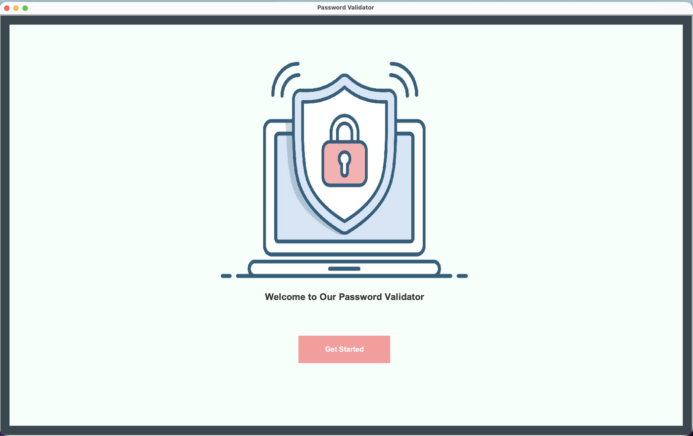
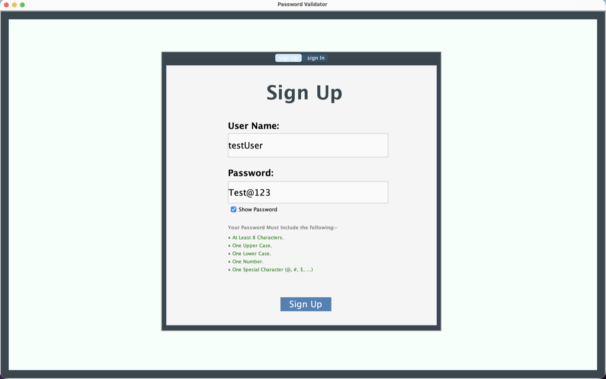
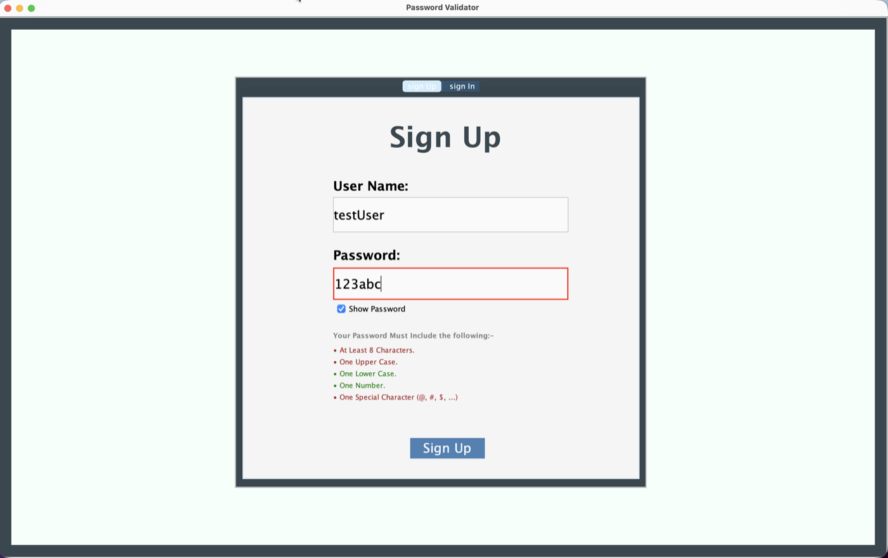
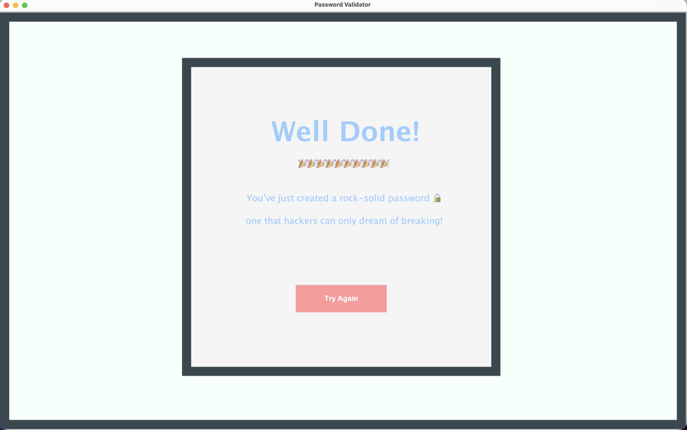
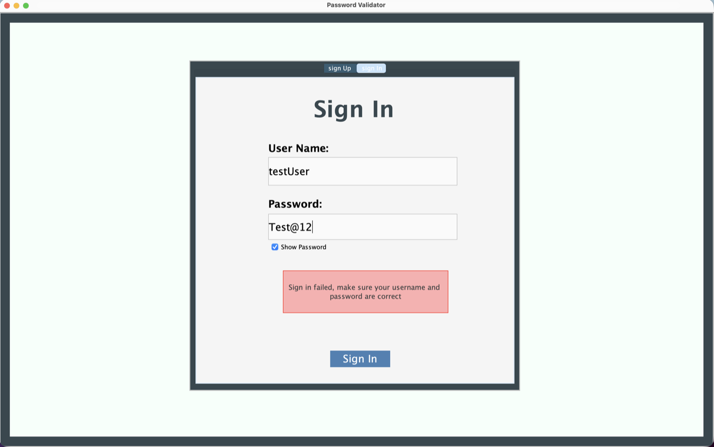

# Secure Password Validator

A Java desktop application (Swing) that enforces a password policy and stores credentials the safe way: **salted SHA-256 hashes in SQLite, never the plain password**.

## Features

- **Password policy validation** at registration:
  - at least 8 characters
  - at least one uppercase letter, one lowercase letter and one digit
  - at least one special character from `@ _ / . $ ! # &`
- **Salted hashing:** each user gets a unique 16-byte random salt (`SecureRandom`); the password is hashed with SHA-256 as `SHA-256(salt + password)`.
- **Persistent storage** in a local SQLite database (`users` table: `id`, `username`, `password_hash`, `salt`).
- **Login verification:** the stored salt is re-applied to the entered password and the hashes are compared in constant time (`MessageDigest.isEqual`).
- **SQL injection protection** through parameterized queries (`PreparedStatement`).

## Screenshots

| Home | Sign up (valid password) |
|:---:|:---:|
|  |  |

| Weak password rejected (live rule checks) | Registration success |
|:---:|:---:|
|  |  |

| Failed sign in (wrong password) |
|:---:|
|  |

## How it works

```
Register:  password ──► validate policy ──► generate salt ──► SHA-256(salt + password) ──► store (username, hash, salt)
Login:     username ──► fetch (hash, salt) ──► SHA-256(salt + entered password) ──► compare with stored hash
```

A stored row looks like this (illustrative values): the hash is 64 hex characters (256 bits) and the salt is 32 hex characters (128 bits). The plain password is never stored.

| id | username | password_hash (hex) | salt (hex) |
|----|----------|---------------------|------------|
| 1 | testUser | `9f2c…e41a` | `5b7d…c03f` |

## Tech stack

Java · Swing · JDBC · SQLite · SHA-256 · SecureRandom

## Project structure

```
src/        Main, Interface (Swing UI), PasswordOperations (policy, salt, hash), DatabaseOperations (SQLite)
lib/        Third-party JARs: sqlite-jdbc 3.47.0.0, slf4j-api 1.7.36, slf4j-simple 1.7.36
resources/  Images used by the UI
docs/       Screenshots
```

## Run it

Requires **JDK 11 or later** (developed and tested with JDK 19).

```bash
# macOS / Linux
javac -encoding UTF-8 -cp "lib/*" -d out src/*.java
java -cp "out:lib/*:resources" Main
```

```bat
:: Windows
javac -encoding UTF-8 -cp "lib/*" -d out src\*.java
java -cp "out;lib/*;resources" Main
```

The database file `hashedPasswordsFile.db` is created automatically in the folder you run the command from.

## Limitations and future work

This project is built to demonstrate the core ideas (salting, hashing, parameterized queries). For a production system I would:

- Replace SHA-256 with a **deliberately slow password-hashing function** such as bcrypt, scrypt, Argon2 or PBKDF2, to resist brute-force attacks.
- Enforce **unique usernames** (`UNIQUE` constraint) and handle duplicates in the UI.
- Add login rate limiting / lockout and a "common passwords" blocklist.
- Add unit tests for the validation and hashing logic and a build tool (Maven/Gradle).

## Credits

University course project, designed and implemented by Shatha Alluhaibi.

Third-party libraries keep their own licenses (sqlite-jdbc: Apache 2.0, SLF4J: MIT).

## License

MIT, see [LICENSE](LICENSE).
